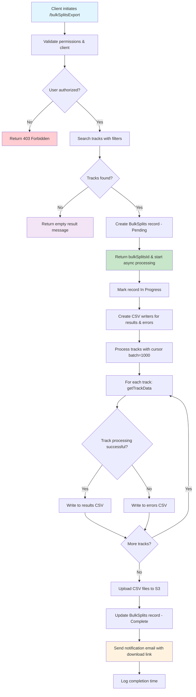

# Fuga - Bulk Splits Export

This module handles the bulk export of track splits data to CSV format for clients. It provides functionality to search, filter, and export track splits information with associated payee details, uploading the results to S3 for client download.

---

## How to Use

The bulk splits export is triggered via API endpoints:

### 1. Initiate Export
```
GET /fuga/v2/bulkSplitsExport
```

### 2. Check Export Status
```
GET /fuga/v2/bulkSplits/:id
```

### 3. List All Exports
```
GET /fuga/v2/bulkSplits
```

---

## Required Permissions

- User must have `catalogue` read access (`allowReadAccessToAll`)
- User must belong to a valid client organization

---

## Export Flow

When initiating a bulk splits export, the following process is performed:

### 1. **Validation & Search**
   - Validates user permissions and client existence
   - Uses `TrackController.searchTracks()` to find tracks matching criteria
   - Applies query filters (tags, excludeTag, etc.)
   - Returns early if no tracks found

### 2. **Export Record Creation**
   - Creates a `BulkSplits` record with status `'Pending'`
   - Stores search filters and total track count
   - Returns immediate response with `bulkSplitsId` for tracking

### 3. **Asynchronous Processing** (via `setImmediate`)
   - Marks export record as `'In Progress'`
   - Creates temporary CSV files for results and errors
   - Processes tracks in batches using MongoDB cursor (batch size: 1000)

### 4. **Track Processing**
   - For each track, retrieves detailed splits data using `getTrackData()`
   - Successful tracks � written to main CSV with splits information
   - Failed tracks � written to error CSV with error details
   - Progress logged every 1000 tracks

### 5. **File Upload & Completion**
   - Uploads generated CSV files to S3 storage
   - Updates `BulkSplits` record with file links and completion status
   - Sends email notification to user with download link
   - Records total processing time

### 6. **Error Handling**
   - Any errors during processing mark the export as `'Errored'`
   - Error message stored in the `BulkSplits` record
   - Failed exports can be retried by initiating a new export

---

## Data Models

### BulkSplits Record Structure
```javascript
{
  _id: ObjectId,
  name: "Splits Export 2024-01-01T00:00:00.000Z",
  clientId: ObjectId,
  organisationId: ObjectId,
  status: "Pending" | "In Progress" | "Complete" | "Errored",
  filter: { tags: "rock", excludeTags: "demo" }, // Request supplied search filters
  count: 1500, // Total tracks found
  updatedCount: 1485, // Successfully processed
  type: "export",
  errorMessage: "", // Error details if failed
  updatedBy: ObjectId, // User who initiated
  file: "https://s3.../splits_export.csv", // Results file
  errorFile: "https://s3.../splits_errors.csv", // Errors file (if any)
  createdAt: Date,
  updatedAt: Date
}
```

### CSV Output Format
**Main Export File:**
- Track ID, Title, Artist, ISRC
- Payee information and split percentages
- Contract details and participation rates

**Error File:**
- Track information that failed processing
- Error descriptions and reasons

---

## API Responses

### Export Initiation Response
```json
{
  "message": "Processing 1500 tracks.",
  "bulkSplitsId": "60f7b8c4d1234567890abcde",
  "totalCount": 1500
}
```

### No Tracks Found Response
```json
{
  "totalCount": 0,
  "message": "Could not find any tracks matching the search criteria."
}
```

### Export Status Response
```json
{
  "_id": "60f7b8c4d1234567890abcde",
  "name": "Splits Export 2024-01-01T00:00:00.000Z",
  "status": "Complete",
  "count": 1500,
  "updatedCount": 1485,
  "file": "https://s3.../splits_export.csv",
  "errorFile": "https://s3.../splits_errors.csv"
}
```

---

## Supporting Functions
- `TrackController.searchTracks()`  Searches tracks with filters and pagination
- `BulkSplits.createExportRecord()`  Creates initial export tracking record
- `BulkSplits.markInProgress()`  Updates status to in-progress
- `BulkSplits.markAsComplete()`  Marks export complete with file links
- `BulkSplits.markAsErrored()`  Handles error states
- `getTrackData(track)`  Extracts detailed track and splits information
- `formatTrackAsCSVRow()`  Formats successful track data for CSV
- `formatErrorAsCSVRow()`  Formats error information for CSV
- `uploadToS3()`  Uploads generated files to S3 storage
- `sendNotification()`  Emails download link to user

---

## Performance Considerations
- **Memory**: Uses MongoDB cursors to process large datasets
- **Batch Processing**: Processes tracks in batches of 1000
- **Asynchronous**: Export runs in background, immediate API response
- **Progress Tracking**: Status updates allow monitoring of long-running exports

---

## Visualised Flow

