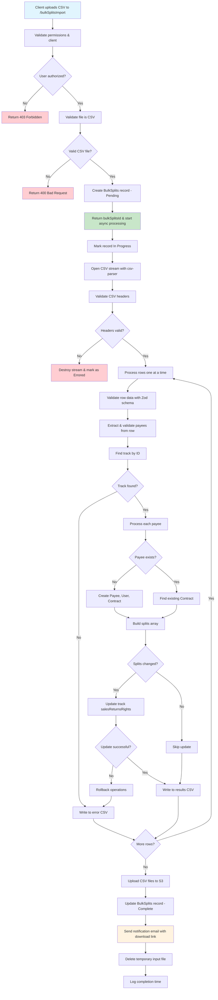

# Fuga - Bulk Splits Import

This module handles the bulk import of track splits data from CSV format for clients. It provides functionality to upload, validate, and process CSV files containing track splits information, automatically creating payees, users, and contracts as needed, and updating track splits accordingly.

---

## How to Use

The bulk splits import is triggered via API endpoint:

### 1. Initiate Import
```
POST /fuga/v2/bulkSplitsImport
Content-Type: multipart/form-data
Body: file=<csv_file>
```

### 2. Check Import Status
```
GET /fuga/v2/bulkSplits/:id
```

### 3. List All Imports
```
GET /fuga/v2/bulkSplits
```

---

## Required Permissions

- User must have `catalogue` read access (`allowReadAccessToAll`)
- User must belong to a valid client organization

---

## Import Flow

When initiating a bulk splits import, the following process is performed:

### 1. **Validation & Upload**
   - Validates user permissions and client existence
   - Validates uploaded file is CSV format
   - Stores file temporarily using multer with naming: `bulk_splits_import_{timestamp}_{originalname}`
   - Creates a `BulkSplits` record with status `'Pending'`
   - Returns immediate response with `bulkSplitsId` for tracking

### 2. **Asynchronous Processing** (via `setImmediate`)
   - Marks import record as `'In Progress'`
   - Creates temporary CSV files for successful imports and errors
   - Opens CSV file stream for row-by-row processing

### 3. **CSV Header Validation**
   - Validates required headers: `ID`, `Asset Title`, `Artists`, `Alternative ID`, `ISRC`
   - Validates payee headers follow pattern: `Payee Name N`, `Payee Email N`, `Payee Participation N`
   - Requires minimum 10 payee columns (30 total payee header fields)
   - Stream pauses during validation and resumes if successful
   - Import terminates if header validation fails

### 4. **Row Processing**
   For each CSV row:
   - **Row Validation**: Validates row data using Zod schema
   - **Payee Extraction**: Extracts payee data (name, email, percentage) from payee columns
   - **Payee Validation**:
     - Ensures all payees have name, email, and percentage
     - Validates total percentages don't exceed 100%
   - **Track Lookup**: Finds track by ID in client's catalogue
   - **Splits Processing**: For each payee:
     - Checks if payee exists by name
     - If payee doesn't exist:
       - Creates new `Payee` record
       - Creates new `User` record with payee association
       - Creates new `Contract` record with default terms (100% Net Receipts, WW territory)
     - If payee exists, finds associated contract
   - **Track Update**: Updates track's `salesReturnsRights` with new splits
   - **Rollback Support**: Tracks all operations for rollback if any step fails
   - Stream pauses during processing and resumes after each row

### 5. **Success/Error Recording**
   - Successful tracks → written to results CSV with updated splits information
   - Failed tracks → written to error CSV with error details
   - Processing continues for remaining rows even if some fail

### 6. **File Upload & Completion**
   - Uploads generated CSV files to S3 storage with 24-hour public links
   - Updates `BulkSplits` record with file links and completion status
   - Sends email notification to user with download link
   - Deletes temporary input file
   - Records total processing time

### 7. **Error Handling**
   - Row-level errors are captured and written to error CSV
   - Database operations are rolled back on failure using operation tracking:
     - New entities (Payee, User, Contract) are deleted
     - Track updates are restored to original state
   - Stream errors mark the entire import as `'Errored'`
   - Error message stored in the `BulkSplits` record

---

## Data Models

### BulkSplits Record Structure
```javascript
{
  _id: ObjectId,
  name: "Splits import 2024-01-01T00:00:00.000Z",
  clientId: ObjectId,
  organisationId: ObjectId,
  status: "Pending" | "In Progress" | "Complete" | "Errored",
  filter: {}, // Empty for imports
  count: 0, // Not used for imports
  updatedCount: 150, // Successfully processed tracks
  type: "import",
  errorMessage: "", // Error details if failed
  updatedBy: ObjectId, // User who initiated
  file: "https://s3.../splits_import.csv", // Results file
  errorFile: "https://s3.../splits_import_errors.csv", // Errors file (if any)
  createdAt: Date,
  updatedAt: Date
}
```

### CSV Input Format
**Required Headers:**
- `ID` - Track ID (MongoDB ObjectId)
- `Asset Title` - Track title
- `Artists` - Track artist(s)
- `Alternative ID` - Alternative identifier (e.g., FUGA ID)
- `ISRC` - International Standard Recording Code
- `Payee Name 1` through `Payee Name N` - Payee names
- `Payee Email 1` through `Payee Email N` - Payee contact emails
- `Payee Participation 1` through `Payee Participation N` - Percentage splits (0-100)

**CSV Output Formats:**
- **Results File**: Same structure as input, reflecting successfully updated tracks
- **Error File**: Track information with error descriptions

---

## API Responses

### Import Initiation Response
```json
{
  "message": "Processing import file: tracks_splits.csv",
  "bulkSplitsId": "60f7b8c4d1234567890abcde",
  "fileName": "tracks_splits.csv"
}
```

### Import Status Response
```json
{
  "_id": "60f7b8c4d1234567890abcde",
  "name": "Splits import 2024-01-01T00:00:00.000Z",
  "status": "Complete",
  "count": 0,
  "updatedCount": 150,
  "file": "https://s3.../splits_import.csv",
  "errorFile": "https://s3.../splits_import_errors.csv"
}
```

---

## Supporting Functions

### Route Handler (routes/fugav2.js:521)
- `validateClient()` - Validates client exists and is valid
- `validateFile()` - Validates uploaded file is CSV format
- `bulkSplitsService.createRecord()` - Creates initial import tracking record
- `importTracks()` - Main import processing function

### Import Controller (controllers/fugav2/imports.js)
- `importTracks()` - Main import orchestration function
- `processRow()` - Processes individual CSV row

### CSV Processing (controllers/fugav2/helpers/import-export/csv.js)
- `validateHeaders()` - Validates CSV header structure
- `validateRow()` - Validates row data using Zod schema
- `extractPayeesFromRow()` - Extracts payee data from CSV columns
- `validatePayees()` - Validates payee data and percentage totals
- `validatePayeePercentages()` - Ensures percentages don't exceed 100%
- `formatTrackAsCSVRow()` - Formats successful track data for CSV
- `formatErrorAsCSVRow()` - Formats error information for CSV
- `createTrackCSVWriter()` - Creates CSV writer for results
- `createErrorCSVWriter()` - Creates CSV writer for errors

### Database Operations (controllers/fugav2/helpers/import-export/db.js)
- `updateTrack()` - Updates track splits and manages payee/contract creation
- `getSplitsAndUpdatePayees()` - Processes payees and creates contracts
- `createPayeeWithUserAndContract()` - Creates new payee, user, and contract
- `rollbackTrackUpdate()` - Rolls back failed operations
- `areSplitsTheSame()` - Checks if splits have changed

### File Management
- `uploadToS3()` - Uploads generated files to S3 storage
- `sendNotification()` - Emails download link to user

### Service Layer (libs/splits/bulkSplits.service.js)
- `createRecord()` - Creates BulkSplits tracking record
- `markInProgress()` - Updates status to in-progress
- `markAsComplete()` - Marks import complete with file links
- `markAsErrored()` - Handles error states

---

## Performance Considerations
- **Streaming**: Uses Node.js streams for memory-efficient CSV processing
- **Row-by-Row**: Processes one row at a time with pause/resume for backpressure handling
- **Asynchronous**: Import runs in background, immediate API response
- **Progress Tracking**: Status updates allow monitoring of long-running imports
- **Rollback Support**: Automatic rollback of failed operations prevents partial updates
- **File Cleanup**: Temporary files are deleted after processing

---

## Automatic Entity Creation

When a payee doesn't exist in the system, the import automatically creates:

1. **Payee Record**:
   - `name` from CSV
   - `email` from CSV
   - Associated with client

2. **Contract Record**:
   - Default name matches payee name
   - Single payee with 100% participation
   - Default sales terms: 100% Net Receipts, WW territory, All categories
   - Default costs terms: 100%, WW territory, All types
   - Active by default
   - Monthly accounting period

3. **User Record**:
   - Email from CSV
   - Associated with payee ID
   - Associated with client

---

## Visualised Flow


