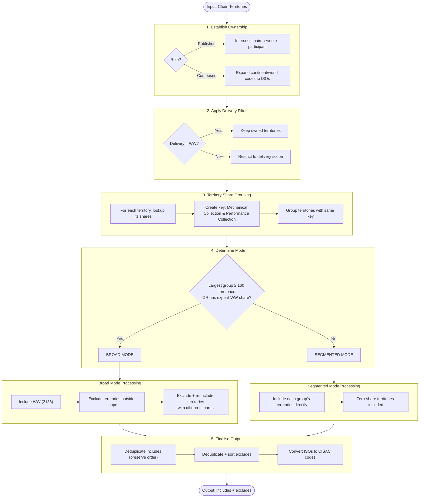

# Territory Chains to CWR Territory Groups

## Overview

This module transforms internal rights chain territory data into CWR (Common Works Registration) compatible territory lines. It is a critical component of the CWR export pipeline, responsible for determining which territories a participant controls and how those territories should be represented in the standardised CWR format.

### Why is this needed?

When registering musical works with collection societies, we must communicate territory-by-territory ownership and collection shares in a specific format. The challenge is that:

1. **Internal representation differs from CWR format** — Curve stores territories as ISO codes with flexible share structures, but CWR requires numeric CISAC codes with include/exclude logic
2. **Shares vary by territory** — A publisher might collect 50% worldwide but 33% in Belgium. CWR needs this expressed as "World minus Belgium, plus Belgium separately"
3. **Efficiency matters** — Rather than listing 200+ individual countries, CWR allows "World excluding X, Y, Z" notation when most territories share the same shares
4. **Multiple chain participants** — Works often have complex ownership with different publishers controlling different regions

### What does it do?

The `territoriesToGroups` function takes a participant's territory chain and produces two arrays:

- **includes**: Territory lines to add (e.g., "World", "Belgium")
- **excludes**: Territories to carve out from broader claims (e.g., exclude Belgium from World claim)

This allows the CWR generator to create the correct SPU/SPT (publisher) and SWR/SWT (writer) territory records.

## Output

```typescript
{
  includes: number[];  // CISAC codes to include (order preserved)
  excludes: number[];  // CISAC codes to exclude (sorted ascending)
}
```

## Key Terms

| Term            | Description                                                        |
| --------------- | ------------------------------------------------------------------ |
| ISO code        | Two-letter country code (e.g. `BE`, `US`)                          |
| CISAC code      | Numeric territory ID for CWR (e.g. `56` = Belgium, `2136` = World) |
| Delivery scope  | Territories for this CWR export (`WW` or specific ISO list)        |
| World threshold | 80% of CISAC countries (160 of 201) triggers world flip            |

## Pipeline



## How "Territory Share Grouping" Works

The bucketing stage groups territories that have identical collection shares together. This is essential because CWR territory lines are per-share-value — you can't have one territory line covering territories with different shares.

### Example

Consider a publisher with these shares:

| Territory | Mechanical Collection | Performance Collection |
| --------- | --------------------- | ---------------------- |
| US        | 50%                   | 50%                    |
| CA        | 50%                   | 50%                    |
| GB        | 50%                   | 50%                    |
| BE        | 50%                   | 33.33%                 |
| NL        | 50%                   | 33.33%                 |

The algorithm creates a **bucket key** by combining the two share values:

```
Key = "{mechanicalCollection}_{performanceCollection}"
```

This produces two buckets:

| Bucket Key | Territories |
| ---------- | ----------- |
| `50_50`    | US, CA, GB  |
| `50_33.33` | BE, NL      |

### Why This Matters

- **Broad Mode**: If one bucket has ≥160 territories (80% of world), we use "World" notation and handle exceptions
- **Segmented Mode**: Each bucket's territories are listed individually

### Share Lookup Order

When determining shares for a territory:

1. `participant.territoryCollection[ISO]` — specific territory share
2. `participant.shares[ISO]` — alternative specific share location
3. `participant.territoryCollection.WW` — global World share
4. `participant.shares.WW` — alternative global share location
5. `default` — fallback bucket (rare)

## Important Behaviours

### World with Territory Override

When a territory has different shares than World (e.g. Belgium with 33% vs World 50%):

1. **Exclude** the territory from World claim (carve a hole)
2. **Include** the territory with its specific shares

Result: Territory appears in **both** `includes` and `excludes` arrays.

### Publisher Excludes

Only applies to primary publishers with non-uniform shares. Excludes territories belonging to other specific chains (when ≤ half of CISAC countries).

### Zero-Share Territories

- **Segmented mode**: Included (required for CWR output)
- **Broad mode**: Excluded from exception handling

## Example 1: Publisher with Territory Override

Let's walk through a complete example to see how the pipeline works in practice.

### The Scenario

**Crown Publishing** is a publisher on a song. They have:

- **Worldwide rights** with 50% mechanical / 50% performance collection
- **Special deal in Belgium** where they only collect 50% mechanical / 33.33% performance

We're exporting to CWR for worldwide delivery.

### Step 1: Establish Ownership

Crown is a **Publisher**, so we intersect:

- Chain territories: `WW` (World)
- Work territories: All 201 CISAC countries
- Participant territories: All 201 CISAC countries

**Result**: Crown owns all 201 countries.

### Step 2: Apply Delivery Filter

Delivery scope is `WW` (worldwide), so no filtering needed.

**Result**: Still 201 countries.

### Step 3: Group Territories by Share Values

We look up the shares for each territory:

| Territory        | Mech Collection | Perf Collection | Bucket Key |
| ---------------- | --------------- | --------------- | ---------- |
| US               | 50%             | 50%             | `50_50`    |
| GB               | 50%             | 50%             | `50_50`    |
| FR               | 50%             | 50%             | `50_50`    |
| ... (197 more)   | 50%             | 50%             | `50_50`    |
| **BE (Belgium)** | 50%             | **33.33%**      | `50_33.33` |

**Result**: Two buckets:

| Bucket     | Count | Territories         |
| ---------- | ----- | ------------------- |
| `50_50`    | 200   | US, GB, FR, DE, ... |
| `50_33.33` | 1     | BE                  |

### Step 4: Determine Mode

The largest bucket (`50_50`) has 200 territories, which is ≥160 (the 80% threshold).

**Result**: We use **Broad Mode**.

### Step 5: Process in Broad Mode

In Broad Mode, we:

1. **Include World (2136)** — covers the dominant bucket
2. **Exclude Belgium (56)** — carve it out from the World claim
3. **Include Belgium (56)** — add it back with its specific shares

This might seem odd, but it's how CWR works: we claim World, then say "except Belgium", then add a separate Belgium line with different shares.

### Step 6: Finalise Output

Convert ISO codes to CISAC numeric codes:

- World → `2136`
- Belgium → `56`

**Final Result**:

```typescript
{
  includes: [2136, 56],  // World, then Belgium
  excludes: [56]         // Belgium excluded from World claim
}
```

### What This Means in CWR

The CWR file will have territory lines like:

| Line | Territory | Include/Exclude | Mech % | Perf % |
| ---- | --------- | --------------- | ------ | ------ |
| 1    | 2136 (WW) | Include         | 50     | 50     |
| 2    | 56 (BE)   | Exclude         | —      | —      |
| 3    | 56 (BE)   | Include         | 50     | 33.33  |

The collection society reads this as: "Crown Publishing collects 50%/50% worldwide, except in Belgium where they collect 50%/33.33%."

---

## Example 2: Segmented Mode

If instead Crown only had rights in 5 countries (US, CA, GB, BE, NL) with varying shares:

| Territory | Mech % | Perf % |
| --------- | ------ | ------ |
| US        | 100    | 50     |
| CA        | 100    | 50     |
| GB        | 100    | 50     |
| BE        | 50     | 33.33  |
| NL        | 50     | 33.33  |

**Step 3** creates two buckets:

- `100_50`: US, CA, GB (3 territories)
- `50_33.33`: BE, NL (2 territories)

**Step 4**: Largest bucket has only 3 territories (well under 160), so we use **Segmented Mode**.

**Step 5**: List each territory directly:

```typescript
{
  includes: [840, 124, 826, 56, 528],  // US, CA, GB, BE, NL
  excludes: []                          // No exclusions needed
}
```

The CWR file lists each country individually with its specific shares.

## Testing

Unit tests: `territoryChains.unit.test.ts`

Regression tests: located in the repo Processor until packages are consolidated

> ⚠️ **Important**: Run regression tests in `processor` repo when making changes.
