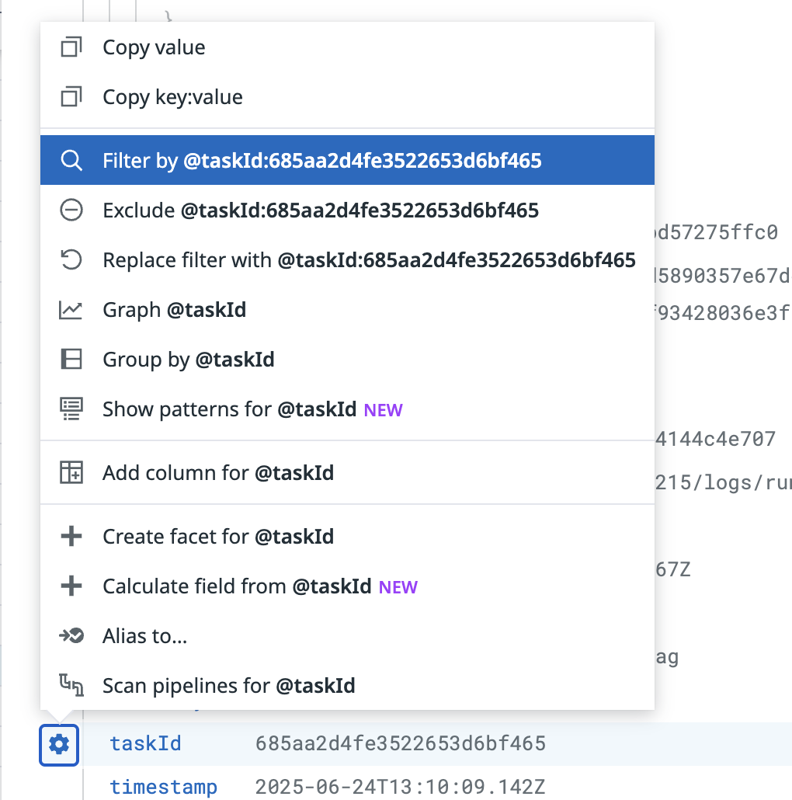

# `@curveroyaltysystems/logger`

A logger which produces JSON logs. Holds information about the Context of the process you are running, and adds these to the logs.

## Introduction

The logger implementation hold an AsyncLocalStorage instance, which allows you to create a Context and add information to it, such as Trace IDs, Task IDs, Task Name, Client ID etc. Once the context has been created, any future log statements will contain this context information.

For example, if you were to run

```js
import { structuredLogger as logger } from '@curveroyaltysystems/platform-shared-utils';

logger.runInContext({ my: 'context' }, () => {
  logger.info('Hello World!');
});
logger.debug('Foo Bar');
```
on AWS, this will print
```json
{ 
  "loggingContextId": "33bd823b-b34f-4dac-abd0-d982a35e6dca",
  "level": "info",
  "message": "Hello World!",
  "timestamp": "2024-01-01T00:00:00.0000",
  "my": "context"
}
```
```json
{ 
  "level": "debug",
  "message": "Foo Bar",
  "timestamp": "2024-01-01T00:00:00.0001"
}
```

The logger will always add the level and timestamp to the log, regardless of if a context is active or not, so we always have this information without it needing to be explicitly stated.

We also create a loggingContextId from a UUID, so there is always a unique identifier for logs generated from a context.

## Prerequisites

This logger expects a new environment variable, `CLOUD_ENVIRONMENT` to be set to either `aws` or `gcp`, in order to configure the underlaying Winston logger correctly to configure the formats and transports relevant for these environments.

If it is not set, it will assume you are running in the code locally. In this case, single line coloured text logs containing the timestamp and level will be produced.

## Usage

### Setting up a Context

In the application you implementing this logger, you will need to create a Context, so we can add information to that context later. To do this, you need to call `runInContext`, which takes an initial context object and a function you want to run in the context.

It's recommended that you set this up as early as possible in the process to capture as much of the process as possible. With a bit of luck, if you are reading this document, this will have already been done for you.

#### Express

In Express, it makes sense to make this an interceptor before we apply our routes, e.g.
```js
import { logger } from '@curveroyaltysystems/logger';
app.use('*', (req, res, next) => logger.runInContext({}, () => next()));

app.use('/tasks', taskRouter); // etc. etc.
```

#### Lambdas

It makes sense to add a context in the initial handler, and pass a function containing the business logic to it

```js
import { logger } from '@curveroyaltysystems/logger';

exports.handler = async function(event, context) {
  return logger.runInContext({ clientId: event.clientId }, myBusinessLogic);
};

async function myBusinessLogic(event) {
  const client = await Client.find(event.clientId);
  logger.addToContext({ clientName: client.name });
  const myResult = doSomeWork(client); // etc. etc.
  return myResult;
}
```

#### Misc Jobs

If you have some job to run (via AWS Batch, Cloud Run Jobs etc.) or some Sandbox script, it makes sense to put this in the entrypoint

```js
const { logger } = require("@curveroyaltysystems/logger");

async function myJob(parameters) {
  // do some work
}

const clientId = process.argv[2];
logger.runInContext({ clientId }, () => myJob(process.argv));
```

### Modifying the context

In your application code, you will need to provide context to the logger.

To do this, call `addToContext`, e.g.
```js
logger.runInContext({ function: 'Hello World Printer' }, () => {
  logger.info('Hello');
  logger.addToContext({ saidHello: true });
  logger.info('World!');
});
```

On AWS, this will print
```json
{ 
  "loggingContextId": "33bd823b-b34f-4dac-abd0-d982a35e6dca",
  "function": "Hello World Printer",
  "level": "info",
  "message": "Hello",
  "timestamp": "2024-01-01T00:00:00.0000"
}
```
```json
{ 
  "loggingContextId": "33bd823b-b34f-4dac-abd0-d982a35e6dca",
  "function": "Hello World Printer",
  "level": "info",
  "message": "World!",
  "saidHello": true,
  "timestamp": "2024-01-01T00:00:00.0001"
}
```

Any code called after the information has been added to the context will be retained, as long as the Context Window is still alive (in other words, the code is called inside the bounds of the function we passed to `runInContext`). This means that, you can:
* Add Context from a utility function, and this context can still be used outside the bounds of the utility function
* Can use Promises and Callbacks, and the context will still be retained.

### Advanced Usage

It's also possible to nest context blocks to create new contexts, create multiple logging contexts for the same function call:
```js
import { logger } from '@curveroyaltysystems/logger';

function makeABatchWorker() {
  const batchTaskId = '5678';
  // Do some stuff
  return batchTaskId;
}

const taskId = '1234';
logger.runInContext({ userId: 'some-user', taskId }, () => {
  logger.info('Gonna make a batch worker');
  const batchTaskId = makeABatchWorker(taskId);
  logger.runInContext({ userId: 'bot', taskId, batchTaskId }, () => {
    logger.info('Doing some batched work');
  });
  logger.info('Did that batch worker thing');
});
```
on AWS, this will print
```json
{ 
  "loggingContextId": "33bd823b-b34f-4dac-abd0-d982a35e6dca",
  "userId": "some-user",
  "taskId": "1234",
  "level": "info",
  "message": "Gonna make a batch worker",
  "timestamp": "2024-01-01T00:00:00.0000"
}
```
```json
{ 
  "loggingContextId": "5f60f6e7-d630-45c7-a8bc-386aee2b6168",
  "userId": "bot",
  "taskId": "1234",
  "batchTaskId": "5678",
  "level": "info",
  "message": "Doing some batched work",
  "timestamp": "2024-01-01T00:00:00.0001"
}
```
```json
{ 
  "loggingContextId": "33bd823b-b34f-4dac-abd0-d982a35e6dca",
  "userId": "some-user",
  "taskId": "1234",
  "level": "info",
  "message": "Did that batch worker thing",
  "timestamp": "2024-01-01T00:00:00.0002"
}
```

## Reading the Context

To actually use the logs produced, you will need to know how to search for logs with the context.

### Datadog

To search for a parameter in a JSON log in Datadog, you can use the `@` symbol to search on a field. For example: `@loggingContextId: 33bd823b-b34f-4dac-abd0-d982a35e6dca` will filter all the logs for that context ID.

It's also possible to select a log entry, and filter by criteria on that log entry. For example:


This dialog also allows you to select a field to display in the table.

### AWS

In Cloudwatch, you can filter by a parameter by using the dollar syntax. So, for example: `{ $.loggingContextId = "33bd823b-b34f-4dac-abd0-d982a35e6dca" }` would filter all logs by a given loggingContextId.

### GCP 

In Logs Explorer, you can filter logs by a parameter by accessing the jsonPayload parameter. So, for example: `jsonPayload.loggingContextId="33bd823b-b34f-4dac-abd0-d982a35e6dca"` would filter all logs by a given loggingContextId.
