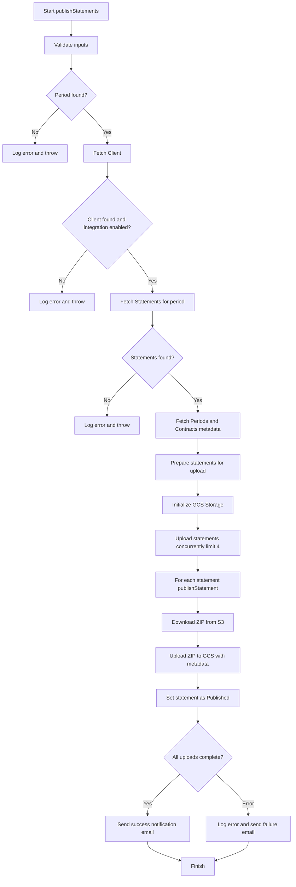

# Fuga - Publish Statements

### 

This module handles publishing statements for a given client period to **Google Cloud Storage (GCS)**, and notifying the client via email. It integrates with **S3** (for downloading statement ZIP files) and **MongoDB** for clients, periods, contracts, and statements.

---

### How to Run

```
node publishFugaStatements.js
```

> The main export `publishStatements` requires a valid period ID and email address (for the notification). These can be set within `publishFugaStatements.js`.

---

### Environment Variables

Running this process requires some extra environment variables which you may not have by default. Add the following to your local .env file, ensuring the values are for our dev GCS instance.

**Important:** Make sure to only use Curve GCP credentials when testing locally so we don't publish statements mistakenly to FUGA.

```
FUGA_GCS_RASA_BUCKET="<gcp-client-email>"
FUGA_GCS_RASA_PRIVATE_KEY="<gcp-private-key>"
FUGA_GCS_RASA_BUCKET="fuga-publish-statements"
```

If this needs testing with FUGA end-to-end, then their credentials can be retrieved from our secrets manager.

---

### Publishing Flow 

When running for a specified Period, the following is performed:

1. **Validate Inputs**  
   - Checks `periodId` and `email`.  
   - Fetches `Period` and `Client`.  
   - Ensures FUGA integration is enabled for the client.  

2. **Fetch Data**  
   - Retrieves all `Statement` records for the period.  
   - Fetches related `Period` and `Contract` metadata.  

3. **Prepare Statements**  
   - Combines statement info with period and contract metadata.  
   - Determines currency, closing balance, and S3 file key.  

4. **Publish Statements to GCS**  
   - Downloads ZIP file from S3 (`fileManager.downloadFromS3Object`).  
   - Uploads ZIP to GCS using `storage.bucket().file().createWriteStream()`.  
   - Metadata for each statement is included in the GCS object.  
   - Marks statement as `Published` in the database.  
   - Concurrency limited via `async.eachLimit` (default 4).  

5. **Error Handling & Notification**  
   - If any upload fails, logs the error and sends a **failure notification email**.  
   - On success, sends a **success notification email** with summary details.  

---

### Supporting Functions

- `getStatements({ clientId, periodId })` — Fetches statements from MongoDB.  
- `getStatementMetadata({ clientId, statements })` — Retrieves periods and contracts, keyed by ID.  
- `publishStatement({ logKey, statement, storage })` — Downloads from S3 and uploads to GCS.  
- `setStatementPublished(statementId)` — Updates statement status to `'Published'`.  

---

### Visualised Flow

